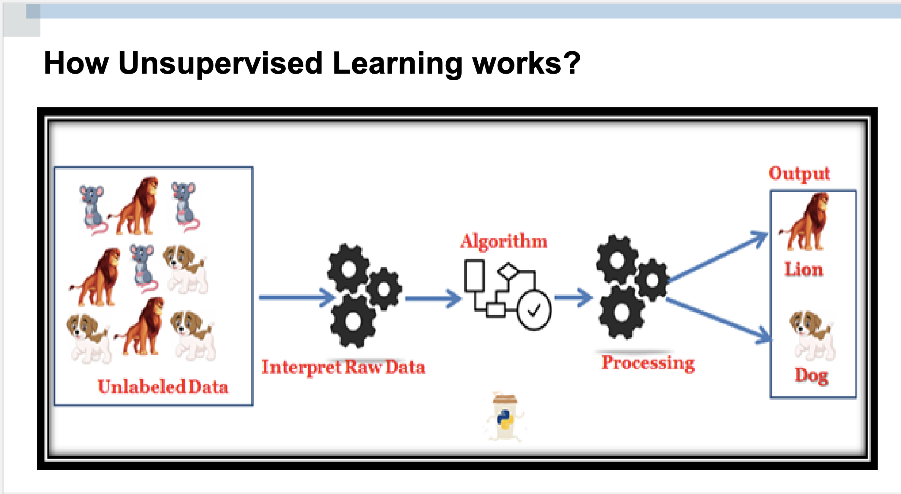
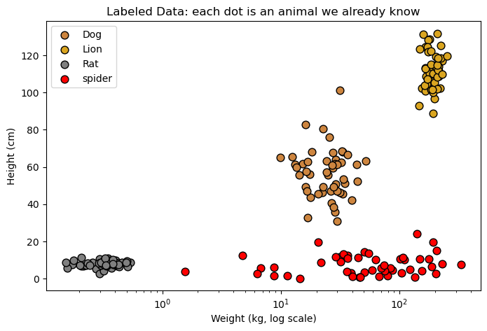
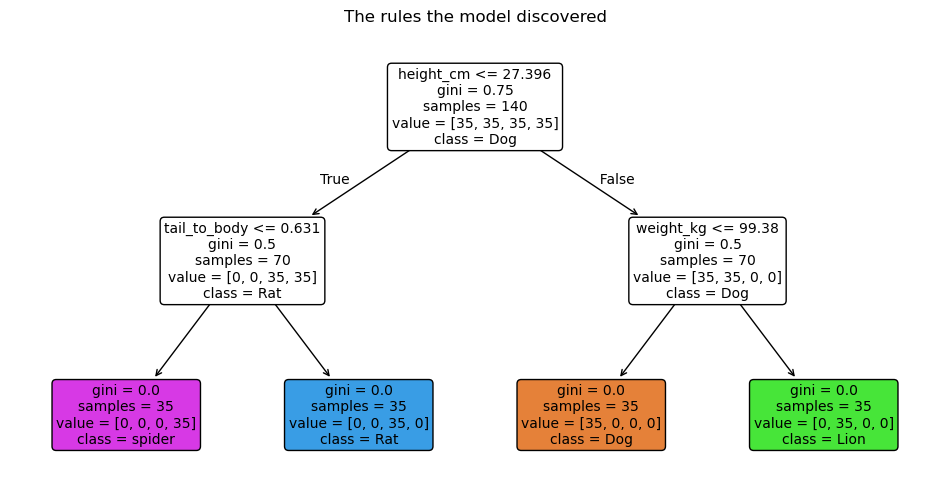
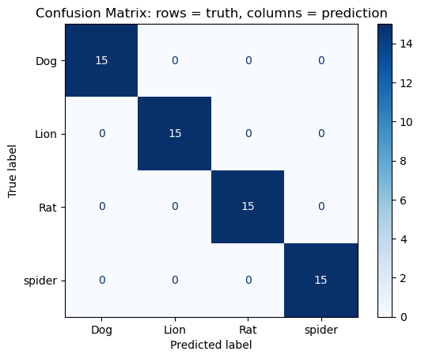

# Supervised Learning: Rat, Dog, or Lion?
**Author:** Lloyd Lewis
**Course:** CAP 4620 Artificial Intelligence, Florida A&M University
**Date:** October 6, 2026
**Environment:** NRP JupyterHub, Python 3 (ipykernel)
## Project Description
This project shows how supervised learning works. A model is trained on
animals whose answers (labels) we already know, and then it predicts the
label of animals it has never seen.
## Project Structure
```
Lab1_SupervisedL/
├── data/ # generated datasets and predictions (CSV)
├── figures/ # plots exported from the notebook (PNG)
├── models/ # trained model (.joblib) and model card (.json)
├── README.md
└── SupervisedL.ipynb
```
## Data
The dataset is **synthetic**: it is generated with NumPy (`np.random.seed(42)`),
with 50 examples per animal class.
| Feature | Meaning |
|---|---|
| `weight_kg` | body weight in kilograms |
| `height_cm` | shoulder height in centimeters |
| `tail_to_body` | tail length divided by body length |
**Label:** `animal` (list the classes, e.g. Rat, Dog, Lion, spider)
| File | Description |
|---|---|
| `data/animals_full.csv` | all generated animals (features + label) |
| `data/train.csv` | training split (70%) |
| `data/test.csv` | test split (30%), hidden during training |
| `data/predictions.csv` | test animals with true vs. predicted label |
## Method
1. Separate features (`X`) from labels (`y`).
2. Split into training (70%) and test (30%) data with `stratify=y`.
3. Train a `DecisionTreeClassifier` (`max_depth = 3`, `random_state = 42`).
4. Predict the test data and evaluate with accuracy, a classification report
and a confusion matrix.
## Model
| File | Description |
|---|---|
| `models/decision_tree.joblib` | the trained Decision Tree |
| `models/model_info.json` | model settings and test accuracy |
Load it with:
```python
import joblib
model = joblib.load("models/decision_tree.joblib")
```
## Results
**Test accuracy:** 100%

*Each dot is an animal. The classes sit in different regions of the plot.*

*The yes/no rule(s) the model learned. First split feature: feature.*

*Rows = true animal, columns = predicted animal. Most confused classes: ....*
## Discussion
1. **Why do we need labels?** Labels tell the model what each training example represents. In this project, the labels identify whether an animal is a Rat, Dog, or Lion. The model uses these known examples to learn patterns between the animal features and their class. Without labels, the model would not know which category each example belongs to or what it should predict for new data.
2. **What would the model predict for a cat, and why is that a problem?** The model would most likely classify a cat as a Rat, Dog, or Lion because those are the only classes it was trained to recognize. A cat is not one of the available labels, so the model cannot identify it as a separate class. This shows why a supervised learning model can only make predictions based on the categories represented in its training data.
3. **Which feature did the tree use first, and why?** The decision tree used `height_cm <= 27.4` for its first split. This means the model selected height to separate the training examples into groups. Although weight may seem useful for distinguishing rats, dogs, and lions, the actual tree shows that height was selected first. This demonstrates the importance of examining the model output rather than assuming which feature the model would use.
4. **How does `max_depth` affect accuracy?** The `max_depth` setting controls how many levels of decisions a decision tree can make. In my project, a maximum depth of 1 produced 50% accuracy on the test data, correctly classifying 30 of 60 examples. The model correctly identified all Dog and Rat examples but failed to identify any Lion or spider examples. This suggests that the tree was too limited to distinguish all four classes. Increasing the depth may help the model make more detailed decisions, although testing different depth settings is necessary to determine whether accuracy improves. A tree that is too deep may also overfit the training data and perform poorly on new examples.
## How to Run
1. Open the project on the NRP JupyterHub.
2. Open `SupervisedL.ipynb` and choose **Run → Run All Cells**.
3. The final cells save the data to `data/` and the model to `models/`.
## Requirements
`numpy`, `pandas`, `matplotlib`, `scikit-learn`, `joblib`
````
